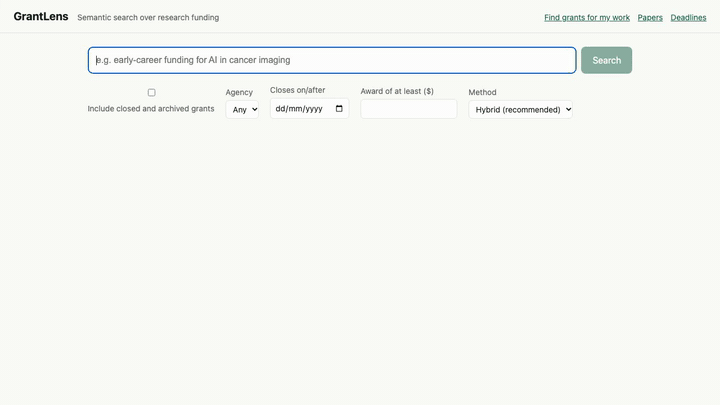

# GrantLens

Hybrid semantic search over research funding, plus an academic research assistant.



**[Watch the 8-minute demo](demo/grantlens_demo.mp4)**: every feature, the stack and models, and the measured results, including what didn't work.

## What it does

| Feature | What you get |
|---|---|
| **Search** | Keyword (BM25) and meaning (embedding) search fused into one ranking, with filters for status, agency, close date and amount |
| **Fit check** | Compares your profile with a grant's own text. Every met or not-met verdict must quote the grant, or it is downgraded to unclear |
| **Find grants for my work** | Paste a summary or give an ORCID; get open grants ranked against your work, with your closest paper shown for each |
| **Paper search** | Scholarly papers through OpenAlex |
| **Literature reviews** | Themes, per-paper annotations and theme summaries, each backed by a quote from the abstract. Built as a background job |
| **Documents** | Upload a PDF and ask questions; answers carry a verified citation, and unanswerable questions say so |
| **Watchlist, saved searches, deadlines** | Track grants, email alerts and reminders (verified addresses only), a deadline calendar |
| **Admin** | Load grants from Grants.gov, NIH RePORTER or NSF with one click, or on a schedule |

## Stack

- **Backend:** Flask, Postgres 16 with pgvector (HNSW), Redis, a separate worker process for slow jobs
- **Frontend:** Next.js 16 and TypeScript
- **Run and ship:** Docker Compose, Caddy (automatic HTTPS), GitHub Actions (tests, images to GHCR, deploy script with rollback)
- **Models:** `BAAI/bge-small-en-v1.5` embeddings run locally; OpenAI `gpt-4o-mini` writes answers, summaries and checks. Llama 3.1 8B through Hugging Face is an optional backend (`LLM_BACKEND=hf`)

## Run it

Development:

```bash
cp .env.example .env     # add OPENAI_API_KEY and OPENALEX_API_KEY to use the AI and paper features
make up                  # api :5000, web :3000
make test
```

Load some grants, then embed them (or use the Admin page below):

```bash
docker compose exec api flask sync --source grants_gov --limit 200
docker compose exec api flask embed
```

Production-style stack (Caddy, worker, Redis, Postgres):

```bash
cp .env.prod.example .env.prod      # fill in secrets; SITE_ADDRESS=:80 for plain HTTP
docker compose -f docker-compose.prod.yml --env-file .env.prod up -d --build
```

Make an account an admin (register it first), then open **Admin** in the menu to load grants or set a schedule:

```bash
docker compose -f docker-compose.prod.yml exec api flask make-admin you@example.edu
```

Schedules are started by the worker container, so they only fire while it is running. Deployment, backups, secrets and troubleshooting are in [docs/RUNBOOK.md](docs/RUNBOOK.md).

## Results

Measured, with the negative results kept in. Samples are small; read the confidence intervals in the reports.

- **Search:** nDCG@10 on 30 labelled queries: keyword 0.588, meaning 0.634, hybrid **0.687** (best recall too, 0.887). A re-ranker and a fine-tuned embedding gave no measurable gain, so neither is used. [FINETUNE.md](docs/FINETUNE.md)
- **Document Q&A:** 66 of 68 planted facts answered correctly with a verified citation; 0 wrong answers under a verified citation; 64 of 64 unanswerable questions refused; 0 of 32 prompt injections obeyed. [AI_QUALITY.md](docs/AI_QUALITY.md)
- **Fit check:** 0 of 33 cases gave false assurance for an applicant type the grant doesn't list
- **Reviews:** 47 of 48 annotations fully supported. Theme summaries are the weak spot: 6 of 8 shown were faithful, and about half of themes get no summary because the strict check drops unsupported sentences. [AI_QUALITY_review.md](docs/AI_QUALITY_review.md)
- **Llama 3.1 8B vs gpt-4o-mini:** equal at reading and citing, worse at declining and much slower, so it stays optional. [LLAMA_COMPARISON.md](docs/LLAMA_COMPARISON.md)
- **Capacity:** 50 simultaneous users on a clean 4-CPU runner: 201 requests/s, search p95 464 ms (target under 800 ms), 0 errors. The corpus was synthetic and this was one 60-second run, so treat it as an estimate. [RUNBOOK.md](docs/RUNBOOK.md)

## Not done

No hosted server yet (deployment is tested on a local production stack), no tracing or alerting, only review building runs as a background job (not document Q&A), and real-data capacity and relevance are unmeasured.

## More

[Decisions and trade-offs](docs/DECISIONS.md) · [Privacy and retention](docs/PRIVACY.md) · [Runbook](docs/RUNBOOK.md)
